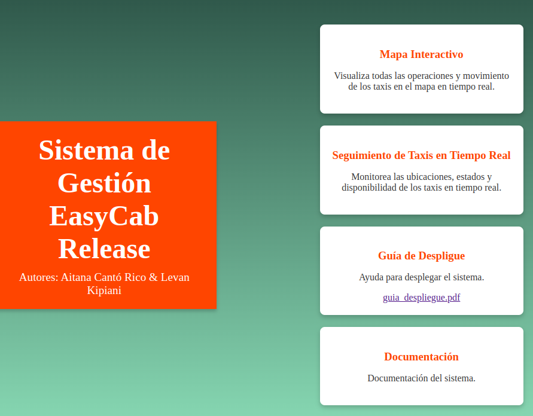
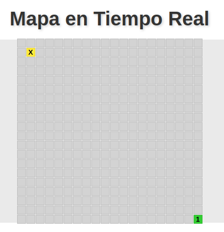
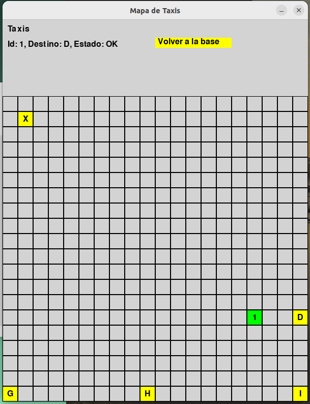
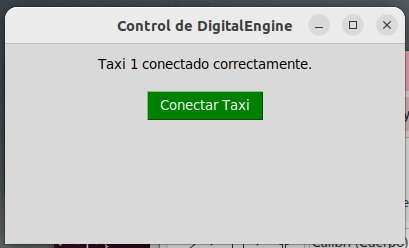
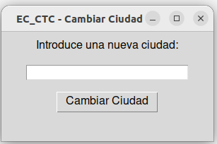
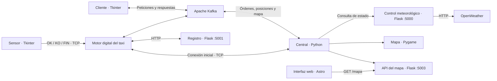

# EasyCab

### Simulación distribuida de una flota de taxis

EasyCab conecta clientes, taxis y una central de coordinación mediante **Apache Kafka, sockets TCP y APIs REST**. El sistema incorpora sensores simulados, control meteorológico y visualización del estado de la flota.

**Python · Apache Kafka · Flask · Tkinter · Pygame · Astro · React · Fernet**

Proyecto académico de **Sistemas Distribuidos**, Universidad de Alicante, curso **2024–2025**.

[Arquitectura](#arquitectura) · [Ejecución local](docs/EJECUCION.md) · [Evolución](#evolución-del-proyecto) · [Memorias](#documentación) · [Equipo](#equipo)

## El proyecto en imágenes

### Parte 2 · EasyCab Release

<p align="center">
  <a href="docs/images/web-release.png"></a>
</p>

<table>
  <tr>
    <td align="center"><a href="docs/images/mapa-web-release.png"></a></td>
    <td align="center"><a href="docs/images/central-release.png"></a></td>
  </tr>
  <tr><td align="center">Visualización web del mapa</td><td align="center">Central y estado de la flota</td></tr>
  <tr>
    <td align="center"><a href="docs/images/motor-digital-release.png"></a></td>
    <td align="center"><a href="docs/images/control-meteorologico.png"></a></td>
  </tr>
  <tr><td align="center">Motor digital del taxi</td><td align="center">Selección de ciudad en EC_CTC</td></tr>
</table>

Imágenes originales extraídas de la [memoria de la parte 2](docs/memorias/Documentaci%C3%B3nParte-2.pdf), páginas 14, 4, 7 y 10 del PDF. Reflejan la versión académica original, no una nueva ejecución ni el diseño exacto de la web actual.

### Parte 1 · Sistema base

<table>
  <tr>
    <td align="center"></td>
    <td align="center"></td>
  </tr>
  <tr>
    <td align="center">Seguimiento de la flota</td>
    <td align="center">Solicitud de un viaje</td>
  </tr>
</table>

Capturas conservadas de la memoria de la parte 1, elaborada por el equipo.

## Evolución del proyecto

La **parte 1** reúne la coordinación de clientes y taxis, la comunicación Kafka/TCP, los sensores y el mapa de escritorio. La **parte 2**, documentada como **«Práctica 3 · EasyCab Release»**, amplía el sistema con control meteorológico, registro de taxis, cifrado, auditoría y una interfaz web conectada a la API del mapa.

Los módulos de esa ampliación ya están incluidos en este repositorio y se describen en la tabla de componentes. La [guía de ejecución](docs/EJECUCION.md) recoge las rutas y la configuración actuales.

## Funcionalidades

- Coordinación de solicitudes de clientes y viajes de taxis simulados.
- Intercambio de peticiones, órdenes y actualizaciones mediante Kafka.
- Conexión inicial de los taxis y comunicación de sensores mediante sockets TCP.
- Simulación de estados de funcionamiento y retorno a base ante condiciones meteorológicas adversas.
- Mapa de escritorio en Pygame y visualización web mediante una API Flask.
- Cifrado Fernet de órdenes y actualizaciones entre la central y los taxis.
- Registro de taxis y auditoría local de eventos.

## Arquitectura



La central combina mensajería asíncrona y conexiones directas. Los procesos utilizan hilos, eventos y bloqueos para coordinar comunicaciones y estado. La persistencia del prototipo se basa en archivos locales compartidos por la central y el registro.

## Estructura

```text
src/                  Módulos Python y rutas compartidas
front/                Interfaz web Astro/React
data/
  requests/           JSON de peticiones de ejemplo
  locations/          Destinos disponibles
  maps/               Posiciones iniciales del mapa
docs/
  images/             Capturas
  memorias/           Memorias de las partes 1 y 2
  guias/              Guía de despliegue original
  EJECUCION.md        Instrucciones de ejecución
secrets/              Configuración local y ejemplo sin credenciales
requirements.txt      Dependencias Python
```

Durante la ejecución se crea `runtime/` para guardar el estado de los taxis, las claves de sesión, los tokens y los registros. Las rutas de datos y estado se calculan desde la ubicación del proyecto.

## Componentes

| Módulo | Responsabilidad |
| --- | --- |
| `src/EC_Central.py` | Coordinación de solicitudes, taxis y estado del mapa. |
| `src/EC_DE.py` | Motor digital de cada taxi. |
| `src/EC_S.py` | Sensor simulado con estados de funcionamiento. |
| `src/EC_Customer.py` | Interfaz de solicitud de viajes. |
| `src/EC_Registry.py` | API de registro y baja de taxis. |
| `src/EC_CTC.py` | Consulta meteorológica y estado de circulación. |
| `src/EC_API.py` | API HTTP del mapa. |
| `src/mapaPygame.py` | Mapa de escritorio y tabla de estados. |
| `src/ec_paths.py` | Rutas compartidas de datos y archivos de ejecución. |

## Ejecución local

Consulta la [guía de ejecución](docs/EJECUCION.md) para preparar el entorno y arrancar los procesos. El escenario descrito utiliza un solo equipo, un broker Kafka con ZooKeeper y una clave propia de OpenWeather.

La [interfaz web](front/README.md) consulta el estado de la central en el puerto `5003` y requiere que los servicios Python estén en ejecución para mostrar datos de la simulación.

## Alcance

EasyCab es un prototipo académico para explorar comunicaciones, concurrencia y coordinación en sistemas distribuidos. Utiliza persistencia en archivos y configuración local. El control meteorológico convierte la temperatura de la ciudad seleccionada en un estado de circulación; no utiliza datos reales de tráfico. Las APIs y conexiones TCP requieren configuración adicional para un despliegue fuera de un entorno local de prácticas.

## Equipo

**Aitana Cantó Rico · Levan Kipiani**

Proyecto desarrollado conjuntamente en pareja.

## Documentación

- [Instrucciones de ejecución](docs/EJECUCION.md).
- [Memoria de la parte 1](docs/memorias/Documentaci%C3%B3nPARTE1.pdf).
- [Memoria de la parte 2 · EasyCab Release](docs/memorias/Documentaci%C3%B3nParte-2.pdf).
- [Guía original de despliegue](docs/guias/guia_despliegue.pdf). Los comandos de este PDF corresponden a la estructura original; para las rutas actuales, utiliza las instrucciones de ejecución.
